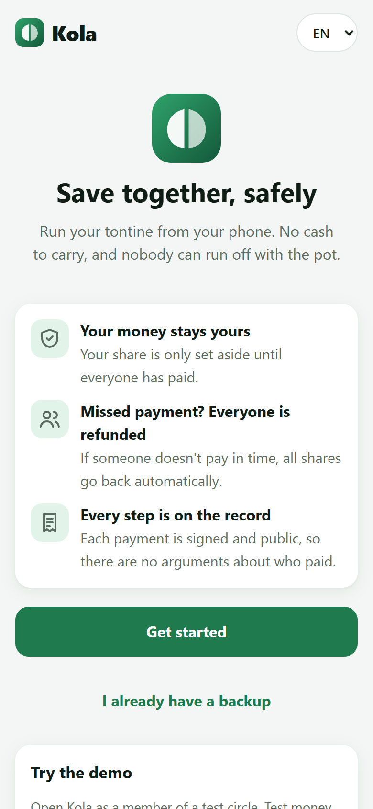
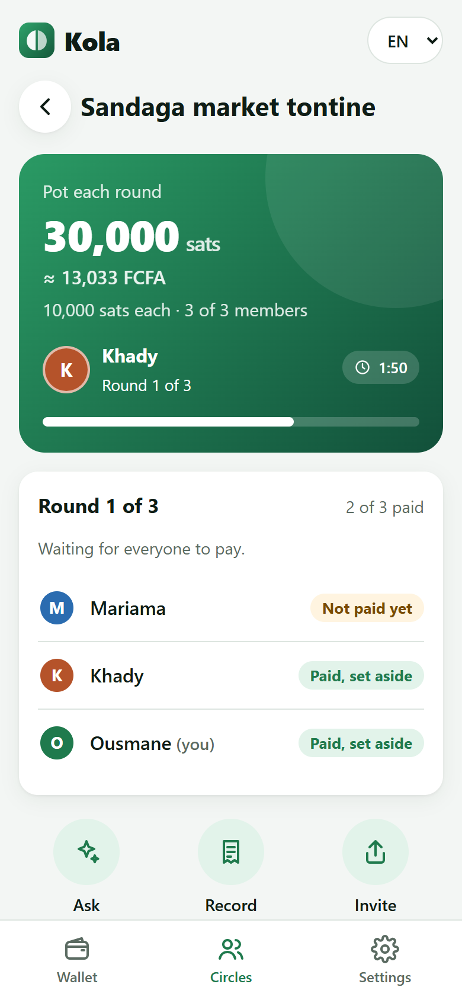
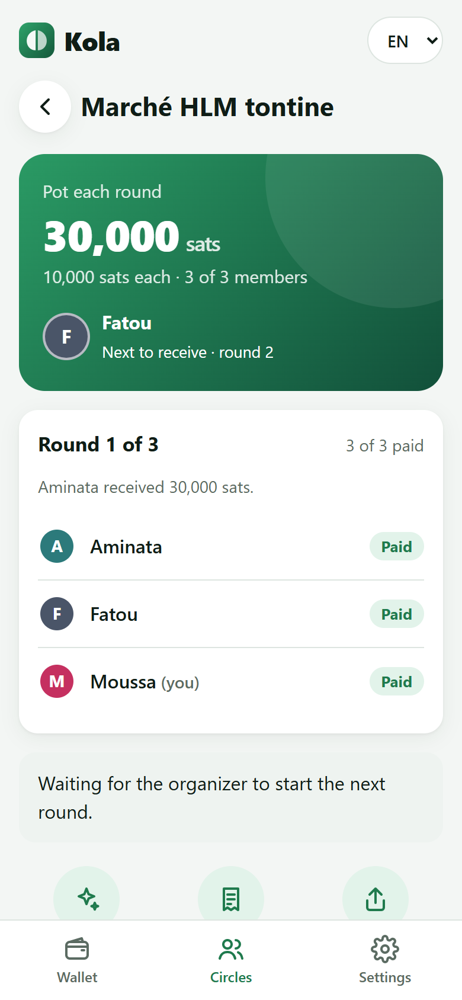
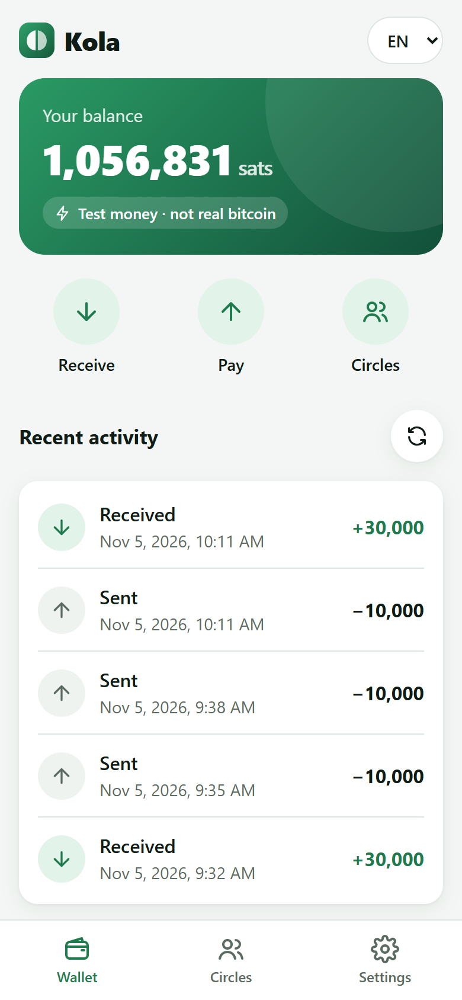
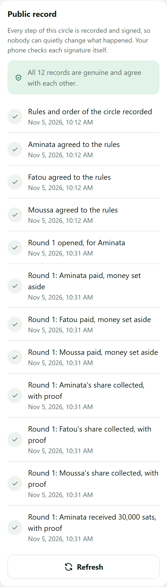
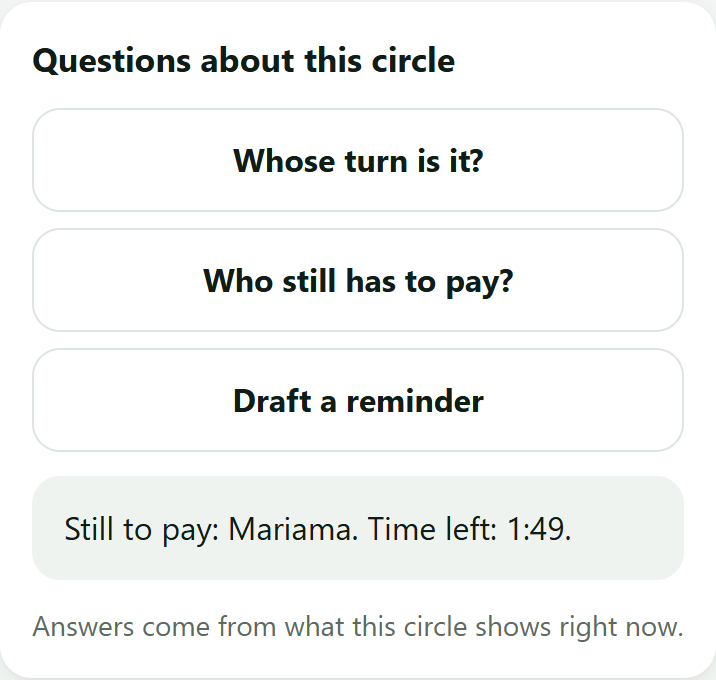
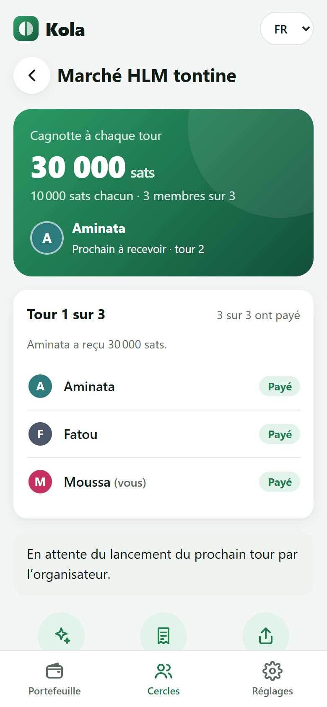
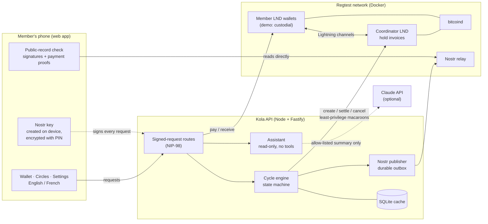
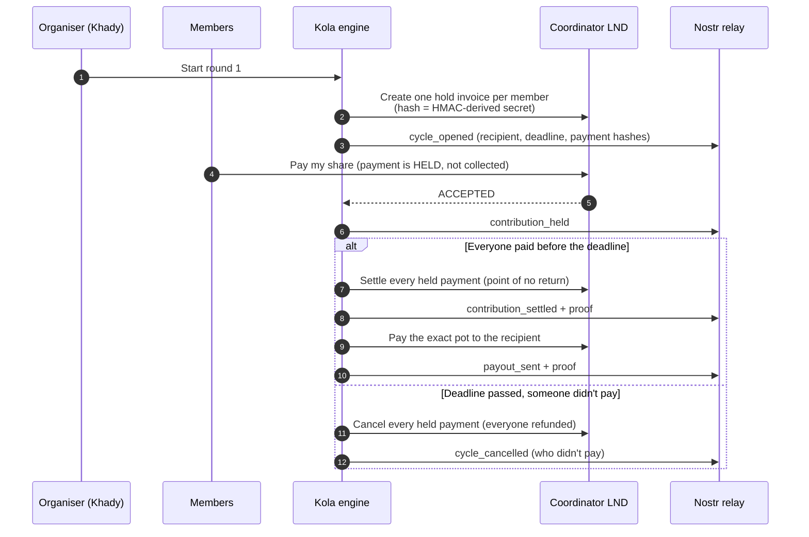

# Kola · savings circles on Lightning

**Run your tontine, ajo or esusu from a phone. Everyone pays their share, or everyone gets their money back, and nobody ever holds the pot.**

Built for the **Dakar Bitcoin Hack 2026 by BTrust**. Open source (MIT). Bitcoin Lightning for the money, Nostr for the public record, AI for help in plain words.

[](https://github.com/lsgnjms/kola/actions/workflows/ci.yml)

### ▶ Try it live: **[kola.2-29-207-59.sslip.io](https://kola.2-29-207-59.sslip.io)**

Open it on a phone or laptop and tap **Khady** (demo PIN 123456). Open the *Sandaga market tontine*, tap **Start round 1** and pay. Then switch to **Ousmane** and **Mariama** in *Settings* to pay their shares, and watch the pot arrive. Test money only (a private regtest network). The demo is shared by everyone and resets daily at 03:00 UTC. Add it to your home screen to use it like an app.

<p align="center">
  
  
  
  
</p>

---

## The problem

Rotating savings circles (*tontine* in Senegal, *ajo* / *esusu* in Nigeria, *susu* in Ghana) are how millions of West Africans save, especially market traders and informal workers who are poorly served by banks. Each member pays the same amount every week; each week one member takes the whole pot.

They run on trust, and the trust is where they break:

- **The collector holds the cash.** They can disappear, or "borrow" from the pot.
- **Disputes.** Records live in a notebook or a WhatsApp chat; nobody can prove who paid.
- **Late payers.** Chasing them is manual and awkward.
- **Distance.** Members who travel or work abroad struggle to pay in cash.

**Our user:** Khady, 34, sells fabric at Sandaga market in Dakar. Mid-range Android, patchy 3G, runs a 10-person tontine with fellow traders. She wants to stop carrying cash and stop arguing about who paid.

## How Kola works

1. **The group creates a circle**: amount, number of people, and the order in which they receive. Others join with a 6-character code.
2. **Each round, everyone pays their share from the Kola wallet.** The money is **set aside, not handed over**: it stays locked in the payment until the round is decided. Nobody can spend it, the organiser included.
3. **When the last person pays,** all shares are collected at once and the pot goes **straight to that round's recipient**, in seconds.
4. **If the deadline passes and someone hasn't paid,** every share is **returned automatically**. No one has to chase anyone, and no one loses money.
5. **Every step is signed and published** to a public record (Nostr). Each member's phone checks the signatures and the payment proofs itself, so the history can't be quietly rewritten.
6. **An assistant answers** "Whose turn is it?", "Who still owes?" and drafts a friendly reminder, in English or French. Invites and reminders go out on **WhatsApp** in one tap, where the group already talks.
7. **Amounts show in FCFA or naira** next to sats ("30,000 sats ≈ 13,000 FCFA"), so nobody has to do the maths.

This works because of a Lightning feature called **hold invoices**: a payment can be held, then either completed or cancelled. Kola only completes them when *every* member has paid.

<p align="center">
  
  
  
</p>

---

## Try it yourself (about 10 minutes)

Everything runs on your computer, on a private **test network**: the bitcoin is not real and nothing touches real money.

**You need:** [Docker Desktop](https://www.docker.com/products/docker-desktop/) (running), [Node.js 22+](https://nodejs.org), Git, and about 4 GB of free memory.

```bash
git clone https://github.com/lsgnjms/kola.git
cd kola
corepack enable        # once: provides the pinned pnpm version
pnpm start             # checks prerequisites, starts the test network, prepares wallets, runs the app
```

The first run downloads the Docker images and funds the test wallets, so it takes a few minutes. When it is ready it prints a link: open **http://localhost:5173**.

### A full round in one browser

1. On the welcome screen, tap **Khady** (the organiser). Demo PIN, if asked: `123456`.
2. **Circles → Sandaga market tontine → Start round 1**, then **Pay my share**.
3. **Settings → Switch demo person → Ousmane**, open the circle, **Pay my share**.
4. **Settings → Mariama**, **Pay my share**. All three have paid, so the 30,000 sats pot goes to Khady immediately.
5. Tap **Record** to see the signed public record, verified on your device.

**See the refund:** Khady starts the next round, only two people pay, and after the 2-minute deadline everyone's money comes back. Check any wallet's activity.

**Start from scratch instead:** in a private window, tap **Get started**, choose a PIN, and create your own circle. Three spare wallets let you run a circle of brand-new accounts: use a different browser or browser profile for each person, because one browser holds one account at a time.

**On a phone:** run `pnpm start:lan` instead and open the printed `http://192.168.x.x:5173` link on a phone connected to the same Wi-Fi.

### Stopping, restarting, resetting

| | |
|---|---|
| Stop the app | `Ctrl+C` |
| Stop the test network **before shutting your computer down** | `pnpm stack:stop` |
| Start again later | `pnpm start` (safe to re-run; it reconnects the nodes) |
| Put the demo circle back to round 1 | stop the app, then `pnpm demo:reset` |

<details>
<summary>Troubleshooting</summary>

- **"Docker is installed but not running"**: open Docker Desktop and wait until it reports it is running.
- **"All test wallets on this server are in use"**: tap **Try a demo person**, or run `pnpm demo:reset` (app stopped) to free them.
- **A port is already in use**: Kola uses 5173 and 3000, plus 7777 and 8081–8087 on localhost only. Stop whatever else is using them.
- **After a crash or a hard shutdown**, run `pnpm start` again. If bitcoind reports height 0, its index was lost but the blocks are intact: restart it once with `-reindex`.

</details>

---

## Architecture

**Money lives in Lightning. The record lives on Nostr. The database is only a cache.**



### One round, step by step



Design decisions that matter:

- **The coordinator never holds money while a round is open.** Shares are held inside the payments themselves. It only holds the pot for the seconds between collecting and paying out.
- **Point of no return = the first collection.** Before it, any problem cancels everything and refunds everyone. After it, the engine only moves forward: collect the rest, pay out, retry the payout until it succeeds. After a crash it reads the real state from Lightning, not its own database, and resumes.
- **Secrets are derived, never stored.** Each payment's secret is `HMAC(coordinator secret, circle, round, attempt, member)`, so a stolen database can't collect anything.
- **Members can't be invented.** Each member's phone signs their own agreement to the rules; the coordinator signs everything else. The audit on the phone rejects anything that doesn't add up: wrong signer, a payment that wasn't announced, a proof that doesn't match, a short pot, or the wrong recipient.

| Nostr event | Kind | Signed by |
|---|---|---|
| Circle rules and order | 33501 (addressable) | coordinator |
| Member agrees to the rules | 3501 | the member |
| Round opened | 3502 | coordinator |
| Share held / collected (with proof) | 3503 / 3504 | coordinator |
| Pot paid (with proof) | 3505 | coordinator |
| Round cancelled, everyone refunded | 3506 | coordinator |

No names, nicknames, phone numbers or join codes are ever published, only pseudonymous keys and amounts in sats.

## Security by design

The full analysis is in **[docs/threat-model.md](docs/threat-model.md)**. Highlights:

- **No passwords.** Each member's key is created on their phone, encrypted with their PIN (NIP-49), and never leaves it. Every request is signed with it (NIP-98), covering the URL, method and body, and can be used only once.
- **Least privilege.** The coordinator never uses Lightning's admin key. It has one key that can only create and settle invoices, and one that can only pay. Neither can open channels or touch on-chain funds. This is verified against the real nodes by `pnpm smoke`.
- **Every input validated** (Zod) at the API boundary. Invoices are decoded and checked for network, amount, expiry and limits before any payment, and a payout must equal the pot exactly.
- **Spend caps** per payment and per day, computed from Lightning's own history so a restart can't reset them.
- **Logs never contain** invoices, payment secrets, keys, names or phone numbers.
- **The AI assistant has no tools.** It sees an allow-listed summary (no keys or payment data), can't trigger any action, and is optional.
- **Proven libraries only:** LND, nostr-tools, noble, zod. No custom cryptography.
- **Stated trust assumptions:** the coordinator could refuse service or delay a payout. Demo member wallets are custodial on the test network. Both are documented, with the path out below.

## Built for mid-range phones on slow networks

- Small first download, built on Preact. Heavier screens (circles, QR code, public record, assistant) load only when opened, and French loads only when chosen.
- One clear action per screen, large tap targets, readable 16px+ text, light theme readable in bright sun.
- Plain words. No jargon: shares are "set aside", not "HTLCs".
- Every error says **whether money moved**: "Your money is still in your wallet."
- English and French throughout, with automated checks that both languages have every message.
- **Installable:** add Kola to the home screen like an app. It opens even on a dead connection (balances and payments always come live from the server, never from a stale copy).
- **Local money:** an approximate FCFA or naira value under every amount (changeable in Settings). The price is fetched by the server, so phones never contact a price site, and it is display only: every payment is in sats.

---

## What's real, and what's not (constraints)

| | |
|---|---|
| **Network** | Regtest only: a private test network with no real money. |
| **Wallets** | Demo wallets are **custodial** Lightning nodes run by the API: 3 for the demo people, 3 spare. Fine for a test network. Real users would bring their own wallet (see next steps). |
| **Coordinator** | A trust assumption: it can't take shares while a round is open, but it briefly holds the pot and could refuse service. Documented in the threat model. |
| **Locked liquidity** | Held payments lock funds along their route until the round is decided, so contribution windows must stay short (2 minutes in the demo, at most 24 hours in production). |
| **Missed payments** | The whole round is cancelled and refunded. Some groups would prefer to go ahead and record the default instead; this is still an open question for real tontine members. |
| **Public record** | One relay. Altered or forged records are never accepted (and anyone posting junk to the relay can't spoil the record); a relay hiding a whole round is not (multiple relays would fix this). The app learns the coordinator's key from the API. |
| **Database** | SQLite is a cache rebuilt from Lightning and the relay. A one-command rebuild is not written yet, and names stay off the relay by design. |
| **Not built yet** | QR scanning (paste works). |
| **Local currency** | Indicative only, from CoinGecko (falling back to mempool.space and the fixed euro–FCFA peg). If both are down the app shows sats only. |

## Metrics we would track

Almost all of these can be computed **from the public record itself**, without collecting personal data:

| Metric | Why it matters |
|---|---|
| Circles created, members per circle, rounds completed | Adoption |
| **On-time payment rate** (shares held before the deadline) | The core behaviour Kola is meant to improve |
| **Payout success rate** and time from last share to payout | Whether members can trust it with their money |
| Rounds cancelled and refunded, and who missed | Group health; feeds the missed-payment policy |
| Disputes raised (target: zero) | The whole point of the public record |
| Assistant questions per member, and which ones | Where the app is still confusing |

**Reach estimate:** one circle of 10 members paying weekly makes 520 payments a year. A single market with 50 circles is about **26,000 payments a year**, on phones people already own.

## Next iteration

1. **Bring your own wallet (NWC).** Members pay from Phoenix, Wallet of Satoshi or any Nostr Wallet Connect wallet. This removes custodial demo wallets.
2. **Pilot with one real group** in Dakar or Lagos on signet, then mainnet with small amounts. Settle the missed-payment policy with them.
3. **Voice in local languages** (Wolof, Yoruba, Pidgin) for reminders and the assistant.
4. **Several relays,** and pinning the coordinator's key in the circle invitation, so the record can't be hidden or substituted.
5. **Receipts in local currency** fixed at the time of payment, QR scanning, and WhatsApp reminders sent automatically before the deadline.
6. **Rebuild command** that restores the cache from Lightning and the relay.

---

## For developers

**Stack:** React-style UI on Preact + Vite + TypeScript · Fastify + TypeScript · Zod · SQLite (`node:sqlite`) · LND (REST) · nostr-tools · Claude API (optional) · Docker Compose · Vitest · GitHub Actions.

```
apps/web/          the phone web app
apps/api/          API server: wallet + circle routes, cycle engine, Nostr publisher, assistant
packages/shared/   Zod schemas, state machine, Nostr event builders and the audit
infra/             docker-compose.yml for the regtest network
scripts/           start, seed, demo, smoke test
docs/              threat model, screenshots
```

```bash
pnpm test               # unit tests (state machine, money rules, audit, routes, screens)
pnpm test:integration   # full rounds on the real test network: payout, missed deadline + refund,
                        # API restart mid-round, public record read back from the relay
pnpm smoke              # Lightning client + least-privilege key checks against the nodes
pnpm lint && pnpm typecheck
```

Optional: put an `ANTHROPIC_API_KEY` in `.env` to let members ask the assistant free-text questions. The quick questions work without it.

## License

[MIT](LICENSE)
